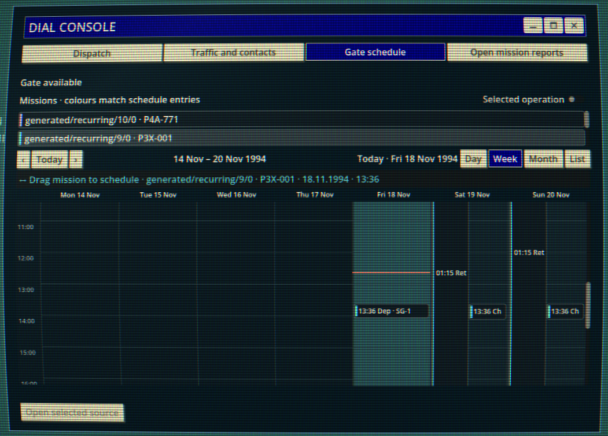

I've mentioned a few details about the setting and some of the features in my first post. Now I want to dig a little deeper into the *why* behind this whole operation.

## Beyond the Mountain Lies ~~Ticino~~ the Setting

Instead of just listing features, I want to explore what I'm actually trying to achieve. What kind of experience do I want to create? What feelings am I trying to evoke?

As a kid growing up in the '90s (commonly known as a *Millennial*), I have fond memories of watching the hit sci-fi series of the time, like *The X-Files*, *Stargate*, and (I watched a lot of BBC back then) *Red Dwarf*.

And then a whole lot of stuff happened, and now I'm almost 40. (Thank you for coming to my TED Talk.)

But seriously, I guess you eventually reach an age where you can step back from the perspective you're used to seeing on television and start looking at things differently.

From a management perspective.

Oh God, how men my age love management.

Specifically, what does General Hammond actually do while the teams are out and about on their televised adventures? Or mostly *untelevised*, considering there were like 20-odd SG teams running around!

Is he sitting in his office, dreaming of retirement and flicking boogers at the wall? Or is he actually monitoring the situation?

*This game is so management-core, it even has an Outlook-style calendar AND weekend work!*

In the series, you could always hear about or catch glimpses of other teams and their exploits. Sometimes they were directly involved in the current plot, but more often than not, their activities were simply part of the background worldbuilding.

I wanted to expand on that. I wanted to be the guy in charge. What happens to those teams? Do they come back in one piece? And what if they don't?
How long will they have to stand down? What consequences do their actions have for the wider universe? How does any of this affect the other teams?
What does it all cost, and who's going to foot the bill? What is the cost of intervening in things that are none of our business? Will Americans ever be able to keep their nose out of things that aren't?

These are the questions that eventually led to this project and, by extension, this blog. Of course, it all had to start 
somewhere: a concept, a few ideas, and some lines of code.

And now here I am. (If anybody asks how I'm going to move forward with all of this, tell them I'll *manage*. And point them towards this blog while you're at it.)

---

*Needless to say, all these Stargate SG-1 references will be removed after the prototype stage. Project Gotthard will have 
its own universe, lore, and setting. I rather like owning the things I create, and I'd very much like to keep them.*
