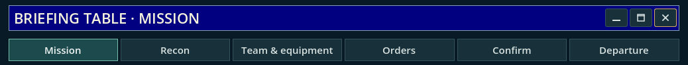
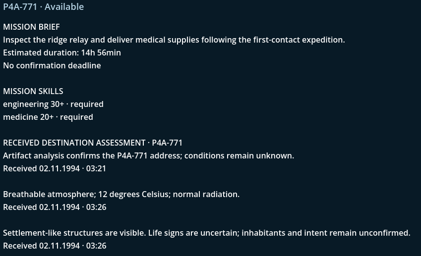
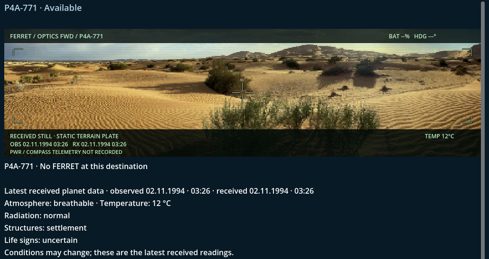
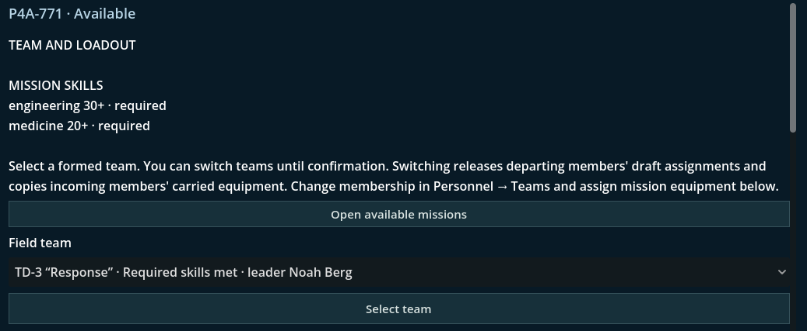
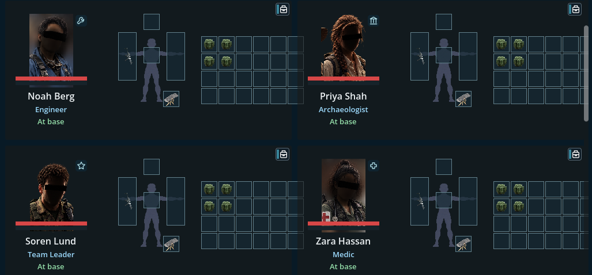
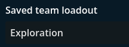
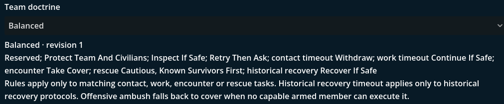
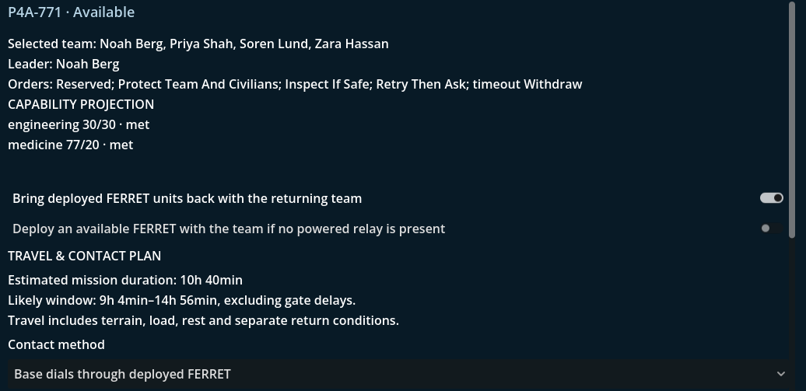
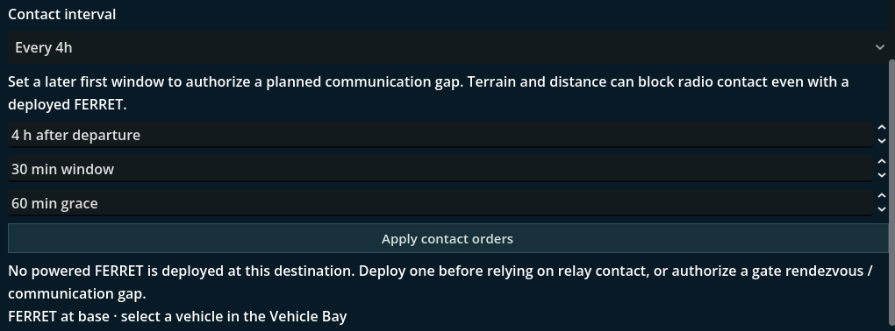
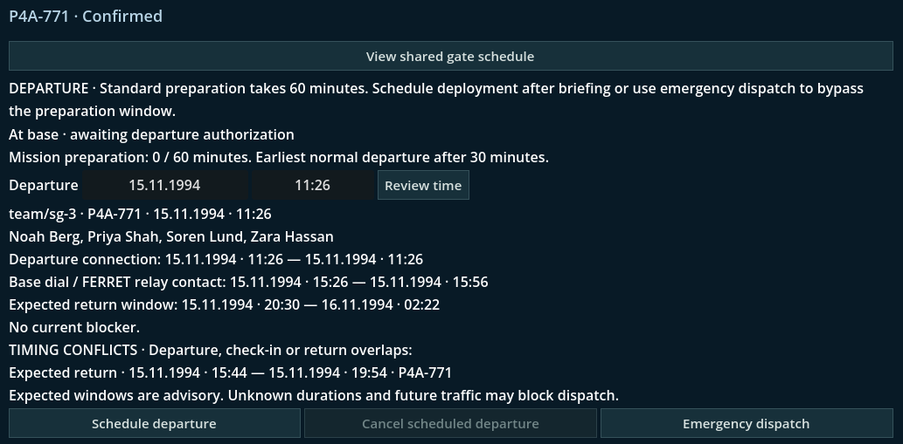

Not in a meta kind of way. This time, at least.

## I'm more like a stay-at-home commander

Climbing the career ladder has one benefit (among many others): The higher you climb, the less likely you are to get shot at.

This also means that you stay at base and miss out on all the adventure. On the other hand, you get to tell other people
what to do and how to get it done. In this Dev Diary entry, I'll walk you through how that works.

I don't need to mention that all this is still a WIP and can change on a whim, or when I'm having a bad day. Or a good one.

_Mission flow at the time of writing_

In _Project Gotthard_, you follow a process from mission briefing to the final send-off. Starting, of course, with...

### Mission Briefing

_Mission briefing, not very brief_

So, apparently, there is a mission available on planet P4A-771 where, after first contact with the local population,
we are supposed to set up comms and deliver medical supplies to make friends with the locals. This
obviously requires certain skills from our team, which we need to consider when choosing its members.

What follows is a bunch of older intel about the place, such as how we got its address, the climate conditions and what the
unmanned recon vehicle FERRET (it's a backronym for _"Forward Expeditionary Reconnaissance something something"_ that I cannot recall
right now and am too lazy to look up) found on its first mission. Further down, there is information about the first contact and
how it went for everyone involved. In this case, probably fine. Otherwise, we wouldn't be able to peacefully return and
build up infrastructure. Hope you paid attention, or it might bite you in the arse.

### Recon

_Beep boop_

OK, we have the old report available. However, it's about two weeks old. At this stage, I could launch another recon mission, just to make
sure that things haven't changed for the worse. It's actually a good idea to deploy a FERRET, as it has sensor capabilities
and can act as a relay for communications. Not a must, though.

### Team & Equipment

_There is no "I" in team unless you spell it wrong_

Unsurprisingly, you have to send some poor souls beyond the Transit Gate. These teams are called _"Transit Detachments"_.
They can be put together to the player's liking, based on a pool of military and civilian talent. God, that sentence sounds
like it's straight from HR hell. Anyway, they need to meet certain skill and equipment requirements before they can head out,
depending on the mission.

_No, not Black Ops. Well, kind of, I guess, but these are just placeholders and not the final product._

A team usually consists of four people. A fifth can be added for specific missions, for instance, if you're missing a linguist
or an archaeologist and don't want to tear the team apart and risk reducing cohesion. Or for escort missions. We all love those.

### Orders

The orders are split into two parts.

_Bring an umbrella or a gun_

Depending on the mission, the player can configure individual team loadouts and save profiles to switch between them quickly. This should make
things a lot quicker than playing with Barbie dolls, but I guess you can do that too if you want. I know I do!

_No, not a female doctor_

Doctrines dictate the behaviour soldiers and scientists display in the field. You can see from the debug information what
this implies. Right now, I have implemented _Defensive_, _Offensive_ and, as seen here, _Balanced_. However, under certain circumstances,
a team leader can choose to ignore these!

### Confirm

Now we have the last details to confirm before we can schedule the team's departure.

_A bit more exciting than "Are you sure?"_

Final checks for skills, equipment, etc., as well as the last chance to grab a FERRET on the way out. Again, communication is quite
important. A deployed team cannot contact base if it's outside radio range or if there is no open Transit Gate connection. Remember,
they're a galaxy away from home!

_Call me maybe?_

This is why you need to agree on when the team should check in. They cannot open the Transit Gate connection home. You have to establish
the connection from your end so they can radio in. If they don't check in, you have no idea what they're up to, whether they're in trouble
or whether they require backup.

This brings us to the last point...

### Departure

_Feels like an airport terminal_

Finally, you can send your boys and gals off to exotic worlds!

Schedule a departure time (usually in an hour), mark all the check-ins and estimated returns in your calendar, and off they go!

You can also send them into the fray straight away, but sending them out unprepared carries risks. Risks you may or may not be ready to take...

## Conclusion

As you can see, there are many mechanics that interact with one another in _Project Gotthard_, and I hope this makes things interesting.
This mission preparation process should feed into the core loop of making decisions that matter in both the short and long term. A well-prepared team
should have a better chance of surviving than a hastily dispatched group of scientists. (Duh!)

I guess that's it for this week's Dev Diary. I hope I've managed to pique your interest a little and, hopefully...

See you in the next post.

Mark
