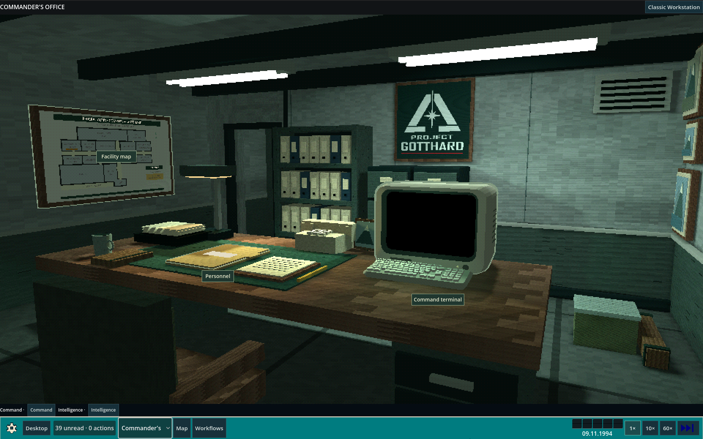
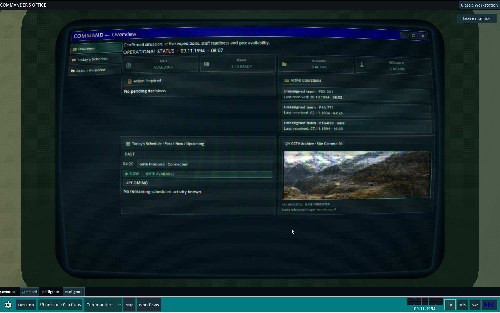

As it turns out, being in command of a top-secret military installation buried somewhere beneath the Swiss Alps has its perks.

You get your own office.

Unfortunately, the view is mostly concrete.

## A Promotion to Middle Management

In my previous posts, I've talked quite a bit about what you actually *do* in Project Gotthard. You assemble teams, send them through the Transit Gate, wait for reports and make decisions that may or may not end in somebody having a very bad day.

What I haven't really talked about is what all of this looks like.

Until recently, the game has been built around what I now call the *Classic Workstation*. Essentially, a collection of windows, menus, buttons and tables. You know, the kind of software that makes you feel right at home if you've ever worked in an office.

It's functional. It does what it's supposed to do.

It's also about as exciting to look at as an Excel spreadsheet.

Now, don't get me wrong. I actually like spreadsheets (but prefer command line interfaces). Probably more than is healthy for a grown man. But there's a difference between managing an interplanetary exploration programme and updating the quarterly sales figures.

At least, I'd hope so.

## Getting Physical

One thing I've wanted from the beginning is for the player to feel like they're actually *in* the facility, rather than looking at it through some abstract management interface.

Think about those old military installations from '90s science fiction. Concrete walls, fluorescent lighting, CRT monitors, filing cabinets, paper reports and a worrying amount of olive-green paint.

I want that. I got that.

_Not pretty, but this not IKEA._

Instead of opening a menu labelled "Personnel", I want to open an actual personnel folder. Instead of clicking a button to view the status of an expedition, I want to look at a monitor or a situation board.

And when the Transit Gate activates, I'd rather see the bloody thing than read a notification telling me that something interesting just happened somewhere off-screen.

So I've started working on what I'm calling the *Physical Workspace*.

The idea is to represent the different departments of the facility as actual 3D rooms, with fixed camera positions and interactive objects.

For instance, the Commander's Office contains a desk, a CRT monitor, physical documents and a facility map. Other departments have their own equipment and interfaces, depending on what you're supposed to do there.

The Briefing Room is where missions belong. The Armory handles equipment. Gate Control, unsurprisingly, has a rather large gate to worry about.

## Welcome to 1994

Of course, there's another problem.

Art.

I've mentioned before that I'm a software engineer, not an artist. Unfortunately, computers are rather particular about this distinction.

I've been experimenting with a visual style inspired by late-'90s games, particularly the original *Metal Gear Solid*. Low-poly geometry, fairly simple textures and lighting that does a lot of the heavy lifting.

Not because I want everything to look deliberately terrible, but because I think the limitations of that era fit the setting rather well.

The game takes place in 1994, after all. I don't want some futuristic holographic interface floating above the commander's desk.

I want a bulky CRT that looks like it weighs more than the person operating it. (Back in 2006, when I was a scrawny 16yo lad I had to swap out all the 22" engineering CRTs for flat screens at the corporate HQ of an international machine building company. I KNOW how heavy they are!)

There's an interesting technical problem here, though. While the rooms can have that low-resolution, pixelated appearance, the information you actually need to read cannot.

Imagine trying to decipher a mission report rendered at the resolution of a postage stamp.

_It's not exactly Windows 95, but I'll take it._

So the approach I'm taking is a hybrid one: low-resolution 3D environments, but crisp documents and readable interfaces. The CRTs can have scanlines, curved glass and all the other imperfections of the period without making the text completely illegible.

At least, that's the goal. Turns out, UX/UI is hard.

## The Office Is Not the Game

There's one thing I want to be careful about.

I don't want to turn Project Gotthard into a walking simulator.

The player is the commander of a military installation. You shouldn't have to navigate three corridors, two staircases and a security checkpoint every time you want to check whether somebody remembered to pack ammunition.

That sounds a lot like commuting.

The rooms therefore use fixed camera perspectives, with direct navigation between departments. Physical objects provide the interaction, while the underlying systems remain the same.

The Physical Workspace isn't supposed to introduce a completely different game. It's another way of interacting with the one I've already been building.

The existing management interface also remains available. Partly because it's useful, partly because I don't want to throw away a considerable amount of work, and partly because I'd rather have a working fallback when one of my ambitious ideas inevitably explodes. (I keep forgetting what I've already implemented)

## So, Where Are We Now?

The current prototype already contains physical interiors for twelve departments, including the Commander's Office, Gate Control, Briefing Room, Laboratory, Armory and several others.

There are interactive folders, monitors, maps and department-specific objects. Some of the actual management interfaces are already accessible through them, rather than being represented by decorative screens, but I wouldn't call this finished.

There is still a lot of work to do on the appearance, the lighting, the feeling of interacting with objects and, most importantly, whether any of this actually makes the game more enjoyable. Also, some people that look busy in the face of an office would be nice.

Because a room full of interactive furniture is still just a room full of furniture if the player doesn't have anything interesting to do.

And this brings me back to the problem I mentioned earlier.

I want the player to feel like they're running an operation, not simply navigating a collection of menus.

If I can make reviewing a mission report feel like something you're doing in an actual military command centre, rather than just reading another text window, that's a step in the right direction.

If not, I've spent a considerable amount of time developing a virtual office.

Which, come to think of it, is a fairly accurate description of my professional career.

Anyway, that's where things stand at the moment. There's a lot more to show once I've got the visuals into a state I'm reasonably happy with. (As you can see, still a LOT of bugs that keep popping up...)

See you next post.

Mark
